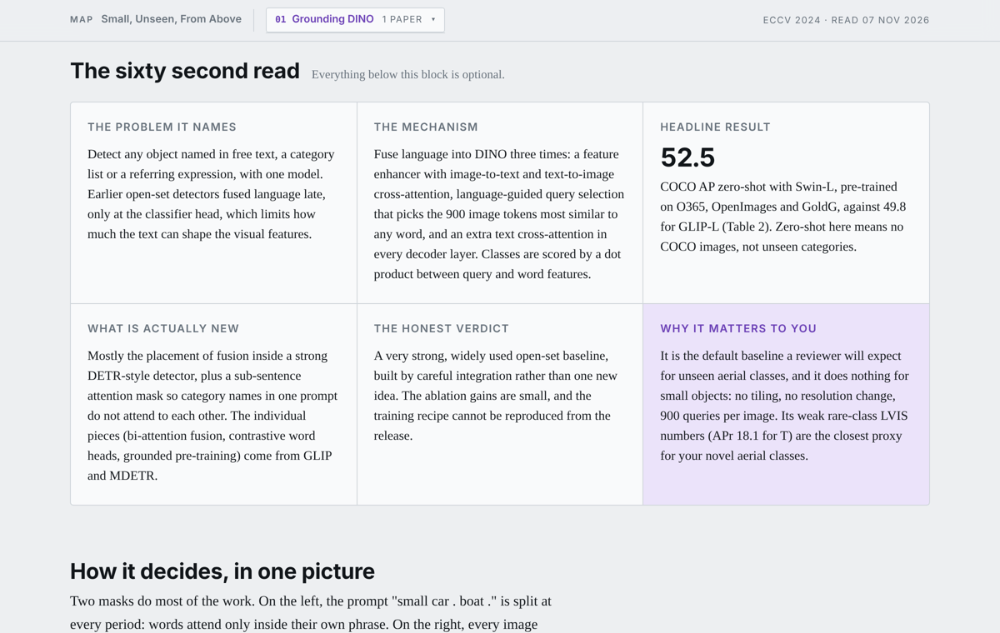
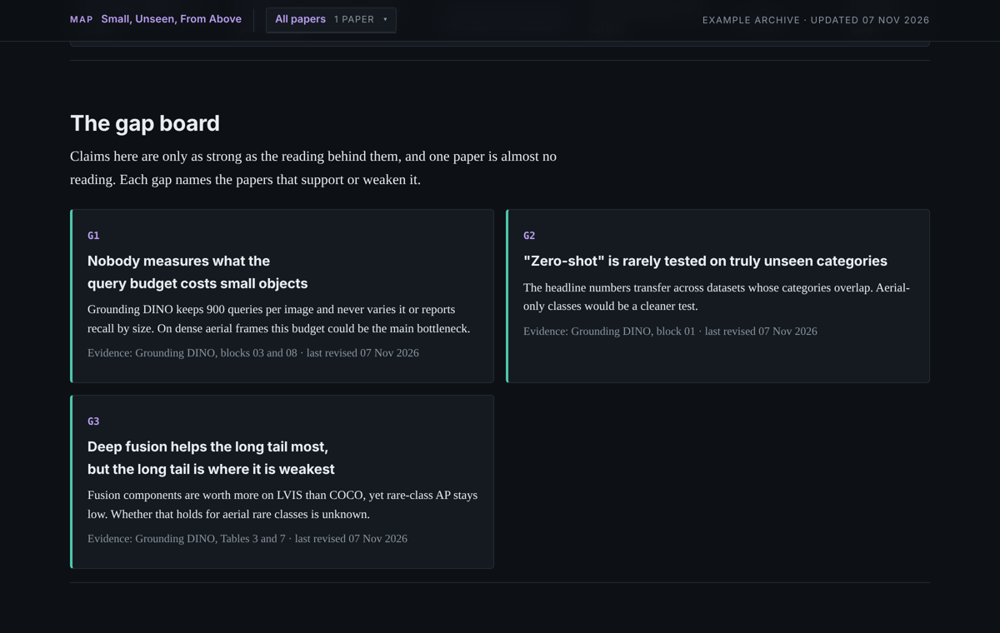

# paper-semantic-map

A Claude skill that turns research papers into deep, visual HTML pages and keeps them in an archive that maps the whole field against your own research question.

I built this to prepare a paper submission. Reading two papers a week was easy; remembering what each one actually did, comparing them on the same terms, and seeing where the open gaps were was not. This skill does that part.



## What you get

**One page per paper**, in two layers:

- On top, always visible: a sixty second read (the problem, the mechanism, the headline number, what is actually new, an honest verdict, and why it matters to *you*), one hand-drawn diagram of the real mechanism, and a sentence you can paste into your related work.
- Underneath, collapsed: the full breakdown. Problem setup, every method component with its equations, every results table with the numbers copied exactly, the released code file by file (including where the code and the paper disagree), the weak points a reviewer would push on, and concrete next steps for your paper.

**One archive page** that ties them together, framed around your question rather than a generic taxonomy: a field map on two axes, a coverage matrix, a gap board that gets revised (not appended) as you read, a reading queue, and a do-not-claim register so you don't claim something a paper already did.



Every page is a single self-contained HTML file. Light and dark mode, works on a phone, no build step.

## Example

[`examples/`](examples/) has a small archive for a made-up reader working on open-vocabulary detection of small objects in aerial images, with one paper read (Grounding DINO, ECCV 2024). Open [`examples/index.html`](examples/index.html) and [`examples/01-grounding-dino.html`](examples/01-grounding-dino.html) in a browser.

## Install

**Claude Code**

```bash
git clone https://github.com/alisoltani7596/paper-semantic-map.git ~/.claude/skills/paper-semantic-map
```

**Claude apps**

Download this repo as a zip and upload it as a custom skill in Claude's settings.

## Use

Start with something like:

> Read the Grounding DINO paper and add it to my paper archive.

The first time, Claude asks a few questions to build your `research-profile.md`: your research question, target venue, the axes you want papers compared on, and your selection rules (venues, years, whether code is required). Every page after that is written for that profile. You can also fill in [`references/research-profile-template.md`](references/research-profile-template.md) yourself.

After that, "read the next paper" takes the top of your reading queue. It also works on a schedule, for example two papers a week.

If Claude can't get the full text of a paper, it tells you and asks for the PDF instead of writing a map from the abstract.

## How it's organised

```
SKILL.md                                  the workflow Claude follows
assets/paper-map-template.html            page template for one paper
assets/index-template.html                page template for the archive
references/paper-map.md                   what each block of a paper map must contain
references/archive-index.md               how the archive page is built and revised
references/research-profile-template.md   your profile, filled once
examples/                                 a one-paper example archive
```

## Notes

- The maps are only as good as the reading. Numbers come from the paper's tables, and anything not checked against the full text is marked as unverified. Still, check the numbers you cite.
- The example map is my reading of a public paper and its public code. Corrections are welcome as issues.

## License

MIT
